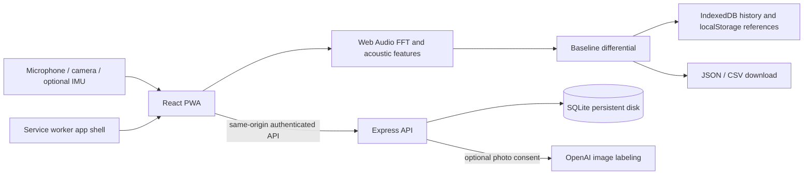

# TouchGPT

A mobile-first, installable material explorer built with React, Vite, Web Audio, and a Node/SQLite API. The app captures microphone spectra, stores personal reference measurements, and compares test objects with those references. It also supports photo capture, browser speech input, local history, JSON/CSV export, private cloud libraries, and optional AI photo labeling.

**This is an experimental acoustic comparison tool, not a validated material-property instrument.** Its percentages describe changes in audio features, not measured physical roughness, hardness, density, or medical characteristics. No previous app or design files were present in the repository; this implementation starts from the original LICENSE-only checkout.

## Run locally

Requires Node.js 24 or later (uses built-in SQLite).

```sh
npm ci
npm run build
npm start
```

Open **http://localhost:3001** on the computer running the app. The same origin serves the PWA and API. Data persists in `.data/touchgpt.sqlite`, excluded from Git.

For development, run these in separate terminals:

```sh
npm run api
npm run dev
```

Vite serves http://localhost:5173 and proxies `/api` to port 3001. The service worker is enabled only in production builds.

### Test on a phone

`localhost` on a phone refers to that phone, not this cloud workspace or your laptop. To use camera, microphone, and motion sensors from a phone, expose the server through a **trusted HTTPS deployment or HTTPS forwarding URL**. A plain LAN HTTP address is not sufficient for sensor APIs. This repository does not automatically publish a public address.

Open the HTTPS address in Safari or Chrome. On iPhone use Share → Add to Home Screen; on Android use the browser's Install app action. Grant microphone and (when available) motion permission after tapping Record. Real hardware testing remains necessary: desktop emulation does not validate phone vibration, friction capture, iOS sensor permissions, or actual camera hardware.

## Measurement workflow

1. Select **Texture**, **Hardness**, or **Density**.
2. Open **Calibration**. Use forearm skin or name a different reference. Gently slide 6 times, tap 5 times, or hold for an 8-second vibration recording. These are instructions, not automatically verified action counts.
3. A successful capture saves that measurement's reference under `TouchGPT_v6_baseline` in localStorage. Each type has its own reference. A failed or cancelled recalibration leaves the previous reference intact.
4. Name the test object by typing or browser speech recognition; optionally capture/upload a photo. Keep your phone, case, grip, pressure, direction, and surroundings consistent with calibration.
5. Record 8 seconds. The app displays live microphone FFT bins and saves averaged features from non-silent frames.
6. View the differential, baseline comparison, and optional motion metadata. Save to browser history, download JSON/CSV, or upload to your account.

Demo measurements use **explicitly labeled sample data**, do not request sensors, and never change calibration. Settings offers a legacy 1–10 heuristic mode without deleting relative references or previous results. It also offers baseline backup/restore. Restoring a backup explicitly replaces the included measurement references; saved result snapshots are unchanged.

Browser storage is not guaranteed forever. Clearing site data or browser eviction can remove it. Download important references and results. Local results/photos use IndexedDB; references use localStorage. Each saved relative result includes a snapshot of the exact baseline used, so later recalibration does not rewrite history.

## What the signals mean

| Selection | Action                              | Comparison feature                                 | Additional saved features                                          | Limits                                                                                                             |
| --------- | ----------------------------------- | -------------------------------------------------- | ------------------------------------------------------------------ | ------------------------------------------------------------------------------------------------------------------ |
| Texture   | Gently slide 6 times                | Power-weighted spectral centroid (Hz)              | RMS, crest factor, rolloff (85%), high-frequency energy ratio, ZCR | Depends strongly on speed, force, case and recording processing; not a roughness measurement                       |
| Hardness  | Gently tap 5 times                  | Spectral centroid × crest factor (heuristic index) | Same time/spectral features                                        | Shape, resonance and contact geometry confound hardness; not a hardness scale                                      |
| Density   | Hold for 8 seconds during vibration | Second-to-fundamental amplitude ratio              | Estimated dominant peak in 100–300 Hz and other features           | Vibro-acoustic response is not uniquely related to density; motor frequency and actual excitation are not verified |

The FFT has 2,048 samples, uses the actual microphone sample rate, and takes magnitude data from Web Audio's analyser. Smoothing is disabled; hardware/software processing may still exist. Requested echo cancellation, noise suppression and AGC are disabled where the device honors those constraints; actual audio settings are saved. The analyser uses its built-in window. Frequency resolution is sample rate / 2,048. The live rendering loop is suitable for exploratory spectra, not precise transient timing.

For a positive baseline feature `b` and test feature `t`:

```
rawPercent = (t - b) / b * 100
shownPercent = clamp(rawPercent, -100, +100)
```

Zero/invalid references and weak captures are rejected. Raw and clipped values are both retained. For example, 1,200 → 3,800 Hz is **+216.67% raw**, displayed as **+100%**, not +60%. Labels deliberately say acoustic difference rather than assert “60% rougher” or “80% harder.” A clipped +100% is not a calibrated physical anchor.

Legacy 1–10 ranges are illustrative mappings, not calibrated to glass, diamond, skin, or steel. The requested glass/paper/sandpaper, rubber/glass/diamond, and foam/ABS/steel references are conceptual examples, not a validated metrology table. Calibration with controlled apparatus and repeated materials/phones would be required to establish any defensible physical relationship.

### Motion telemetry

Where permission and non-null motion events are available, the app records peak linear acceleration, peak angular rate, sample counts, mean acceleration direction, and a damped signed-axis integration estimate of speed. It **does not** integrate acceleration magnitude as a true speed, treat gravity as linear motion, infer stopping from zero acceleration, or fabricate missing sensor values.

Estimated speed drifts and is not calibrated; it is included only as experimental metadata. Validated speed/force normalization, reliable sweep direction detection, 5–30 cm/s enforcement, and sub-millisecond audio/IMU contact lag are **not implemented**: browser IMU sampling, audio latency and orientation prevent those physical claims. Contact lag is explicitly `null`/unavailable and `normalizationApplied` is false. Audio-only capture remains possible when motion is unavailable. Density capture is blocked when vibration is unsupported/refused, including typical iOS browsers; a successful vibration API call still does not prove the motor physically ran.

Use light contact; avoid sharp, dirty, abrasive or fragile surfaces and do not press or obstruct the microphone opening. This is not a medical or skin diagnostic tool.

## Storage API and optional AI

There is no general-purpose “ChatGPT cloud storage” service for this app. The included **TouchGPT storage backend** becomes cloud storage when deployed to your server with a persistent disk. The current running server is only this workspace's instance.

- Register/login with email and a 12–128-character password.
- Passwords are salted with scrypt. Opaque sessions use HttpOnly, SameSite cookies; only session hashes are stored.
- Every record read/write/delete is scoped to its authenticated user.
- JSON-only same-origin writes, input validation, upload limits, and basic request rate limiting are included.
- A user can store up to 500 records. There is no email verification, password recovery, multi-instance rate-limit service, or managed backup system. Add those before operating a public commercial service.
- `/api/health`, `/api/session`, `/api/register`, `/api/login`, `/api/logout`, `/api/records`, `/api/records/delete`, `/api/recognize` implement the API.

Copy `.env.example` to `.env` only if you need to customize settings. Never commit real credentials.

```dotenv
PORT=3001
DATA_DIR=.data
COOKIE_SECURE=true
TOUCHGPT_AI_KEY=your-server-side-key
OPENAI_MODEL=gpt-4.1-mini
```

In Codex environment settings, supply the `TOUCHGPT_AI_KEY` secret for `api.openai.com`. `OPENAI_API_KEY` is also accepted for conventional deployments, but that name is reserved by the cloud environment configuration.

Set `COOKIE_SECURE=true` on HTTPS deployments. Leave it false for local HTTP testing. AI labeling is optional and needs a valid server-side key, account sign-in, and outbound HTTPS access to `api.openai.com`. The UI asks before transmitting a photo. Without a key, the server reports that labeling is unconfigured; manual labels, sensing, storage and exports still work. API credentials are never sent to the browser. AI output is a suggestion, not ground truth. Browser speech recognition may transmit audio to the browser vendor's speech service.

Photos are resized to 900px and encoded as JPEG before local storage/upload. Recorded audio is analysed locally but not stored or uploaded as a raw audio file. Exports contain derived features, baseline data, and sensor metadata; JSON also includes the selected photo.

## Architecture



Offline support caches the versioned app shell, icons, JS, CSS, and bundled fonts. Authenticated API responses and uploaded records are **never** cached by the service worker. Uploads require connectivity and are not automatically queued. A new service-worker version activates after old app tabs close, avoiding a forced mid-measurement refresh.

## Checks

```sh
npm test             # DSP/math/export and authenticated API tests
npm run build        # production assets and offline cache generation
npm run test:e2e     # mobile-sized Chromium workflows and synthetic microphone
```

Browser tests default to `/usr/bin/chromium`; set `CHROMIUM_PATH` to a locally installed Chromium executable. Tests cover navigation, local history persistence, download, legacy mode, actual Web Audio with a synthetic microphone, permission denial, and offline app launch. Synthetic microphone results validate software plumbing, not physical material measurements. Test artifacts/databases are excluded from Git.

## Cloudflare Workers / Pages

For the GitHub deployment settings, static-assets fix, D1 setup, and optional AI secret, follow [CLOUDFLARE.md](CLOUDFLARE.md). `wrangler.jsonc` builds and serves `dist`; `cloudflare/api.js` supplies the D1 backend on Workers and Pages Functions. The original Node/SQLite workflow below remains supported.

## GitHub and deployment

The source tree is intended for https://github.com/TassParitt/TouchGPT. Commit the source, `package-lock.json`, docs, CI, and public icons. Do not commit `.env`, `.data`, `node_modules`, or build artifacts. CI runs tests and a production build on pull requests and pushes.

For a Node hosting provider: build with `npm ci && npm run build`, start with `npm start`, set Node 24+, expose port 3001 (or `PORT`), mount persistent storage at `DATA_DIR`, and configure HTTPS and secure cookies. Back up SQLite using its online backup facility or after stopping the server; copying only the main file while WAL writes run is not a safe backup.

A Dockerfile is included:

```sh
docker build -t touchgpt .
docker run --rm -p 3001:3001 -v touchgpt-data:/app/.data --env-file .env touchgpt
```

Place the container behind your HTTPS reverse proxy. Docker deployment is provided but must be validated on your chosen host. GitHub Pages alone cannot run the API. **Cloudflare Pages with the included Functions and a D1 binding** supports cloud storage/AI; static-only hosting does not.
